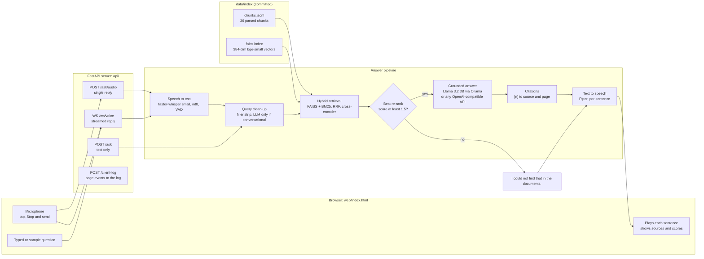
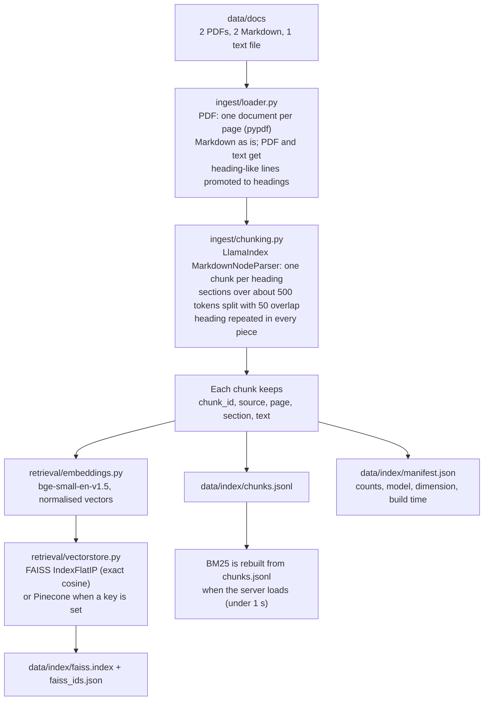
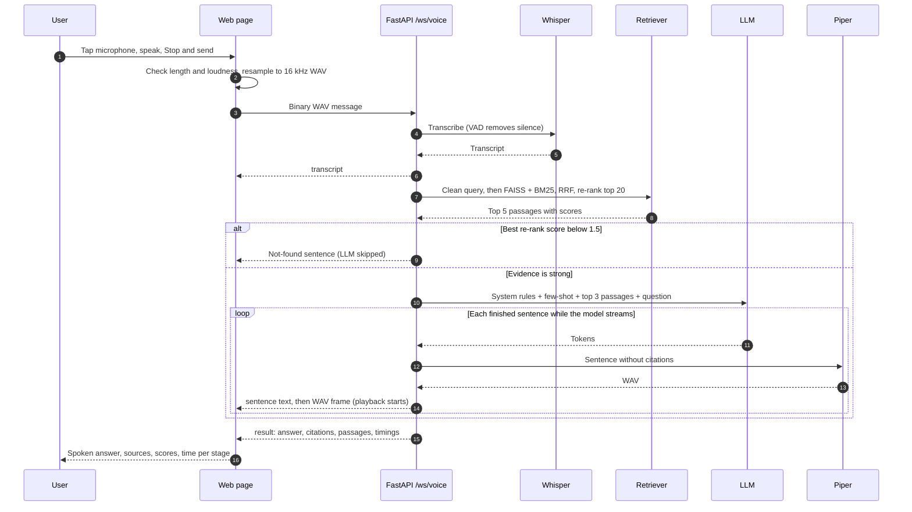
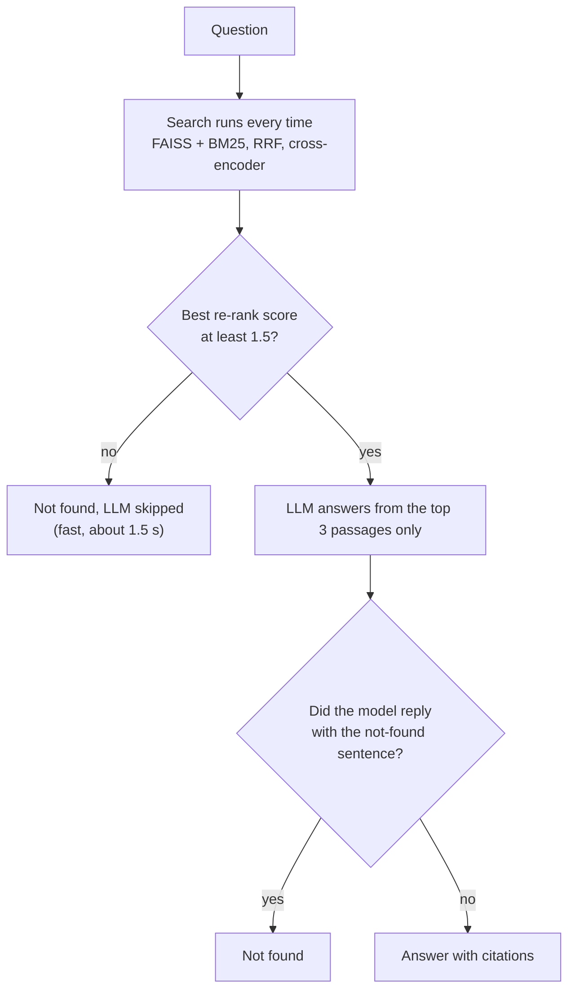

# Architecture

Purpose: how the Voice RAG Assistant is built, how a question flows through it, what each stage is for, and what the committed parsed documents contain. The diagrams are Mermaid, which GitHub renders as pictures.

Created by: Srikar Gupta
Created date: 2026-11-26
Updated by: Srikar Gupta
Updated date: 2026-11-26

Change log:

- 2026-11-26, Srikar Gupta: First version: system overview, ingestion, query flow, streaming, not-found decision, parsed documents, design choices.

## 1. System overview

## 2. Ingestion: from documents to the index

Run with `vra ingest` (or `POST /ingest`). It rebuilds the whole index from `data/docs`.

## 3. One voice question, step by step (streamed reply)

"Single reply" mode sends the same WAV to `POST /ask/audio`, which runs the same pipeline and returns one JSON response with the whole reply as one WAV.

## 4. How "not found" is decided

Search always runs. "Not found" means the best evidence was too weak, not that search was skipped.

On the 35-question golden set the first gate is right 32 times. The two unanswerable questions it lets through are declined by the model itself. Its one real miss is "How can I get coverage for sewer backup?": search ranks the right page first, but the page is mostly a list of exclusions, so the re-ranker scores it low.

## 5. The parsed documents (`data/index`)

| File | What it holds |
| --- | --- |
| `chunks.jsonl` | One JSON object per chunk: `chunk_id` (`source:page:n`), `text` (heading plus body), `source`, `page` (PDFs only), `section`. This is exactly the text that search and the model see. |
| `faiss.index` | The 36 chunk vectors (384 dimensions, normalised) in an exact inner-product index. |
| `faiss_ids.json` | Maps FAISS row numbers back to `chunk_id`. |
| `manifest.json` | Documents read, sources, chunk count, largest chunk, embedding model, dimension, vector store and build time. |

The source documents in `data/docs` describe two fictional companies written for this project (see [DATA_SOURCES.md](DATA_SOURCES.md)). Rebuild the index after changing them with `vra ingest`.

## 6. Module map

| Stage | Module | Main class or function |
| --- | --- | --- |
| Settings | `configs/settings.py`, `configs/default.yaml` | `Settings`; override with `VRA_<GROUP>__<FIELD>` |
| Loading | `ingest/loader.py` | `load_documents()` |
| Chunking | `ingest/chunking.py` | `chunk_documents()` |
| Index build | `ingest/build.py` | `build_index()` |
| Embeddings | `retrieval/embeddings.py` | `SentenceTransformerEncoder` |
| Vector store | `retrieval/vectorstore.py` | `FaissStore`, `PineconeStore` |
| Keyword search | `retrieval/bm25.py` | `BM25Index` |
| Fusion | `retrieval/fusion.py` | `reciprocal_rank_fusion()` |
| Re-ranking | `retrieval/rerank.py` | `CrossEncoderReranker` |
| Retrieval | `retrieval/retriever.py` | `HybridRetriever.retrieve()` |
| Query clean-up | `rag/rewrite.py` | `prepare_query()` |
| Prompts | `rag/prompts.py` | `build_answer_messages()` |
| LLM clients | `rag/llm.py` | `OllamaClient`, `OpenAICompatClient` |
| Citations and not-found | `rag/citations.py` | `evidence_is_weak()`, `resolve_citations()` |
| Sentence streaming | `rag/sentences.py` | `SentenceSplitterStream` |
| Pipeline | `rag/pipeline.py` | `AnswerPipeline.stream_answer()` |
| Speech | `voice/stt.py`, `voice/tts.py` | `WhisperSTT`, `PiperTTS` |
| API | `api/main.py`, `api/routes.py` | `create_app()`, `/ask`, `/ask/audio`, `/ws/voice`, `/client-log` |
| Web page | `web/index.html` | Recorder, playback, results |
| Evaluation | `eval/` | `retrieval_eval`, `answer_eval`, `gate`, `report` |

## 7. Why each design choice

| Choice | Reason |
| --- | --- |
| Heading-based chunks, about 500 tokens, 50 overlap | One topic per chunk; overlap keeps boundary facts whole; heading repeated so each chunk stands alone |
| bge-small-en-v1.5 | Small (384 dimensions), strong retrieval quality, fast on a CPU; query instruction prefix on queries only |
| Normalised vectors and FAISS flat index | Inner product equals cosine; exact search is under a millisecond at this size |
| BM25 next to dense search | Catches exact words such as fee names, amounts and form numbers that embeddings blur |
| Reciprocal rank fusion, k = 60 | Uses ranks only, so dense and BM25 scores never need calibrating |
| Cross-encoder re-ranker on the top 20 | Reads question and passage together; lifted Recall@5 to 1.000 and MRR to 0.978 |
| Evidence gate on the re-rank score | Weak evidence never reaches the model: no invented answers, no wasted model call |
| Numbered citations | Small models copy [1] reliably but mangle file names; code maps numbers to source and page |
| Few-shot with fictional examples | Teaches the citation format and the exact not-found reply without leaking facts |
| Sentence-by-sentence speech over a WebSocket | The user hears the first sentence while the model is still writing |
| Local models with a hosted switch | Runs free on a CPU laptop; one setting moves the LLM to a hosted API for the cloud |
